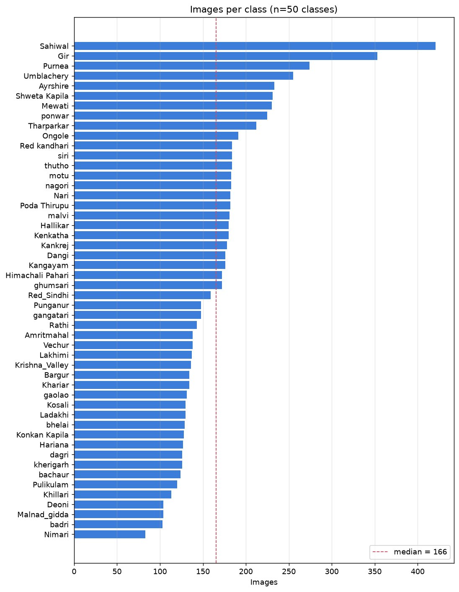
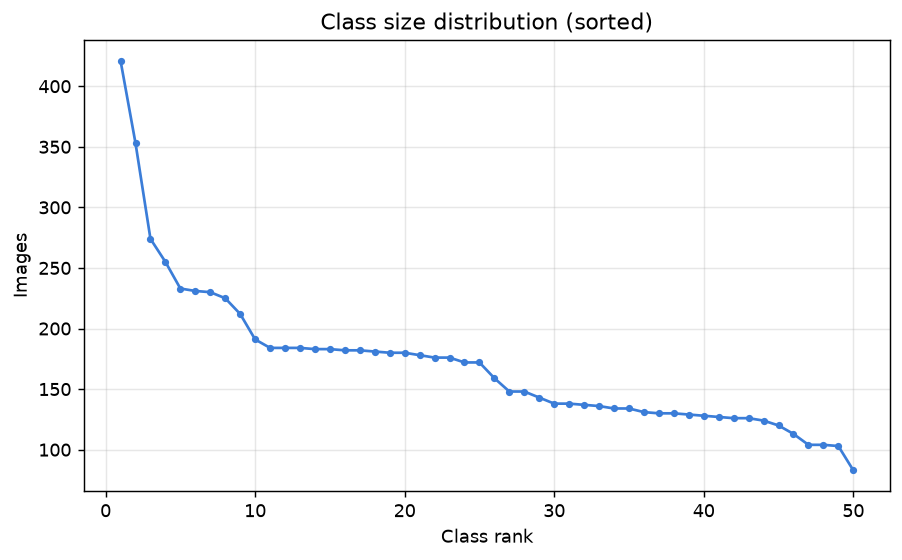
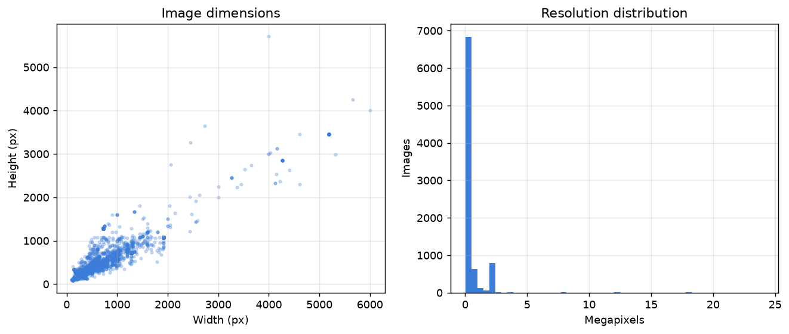
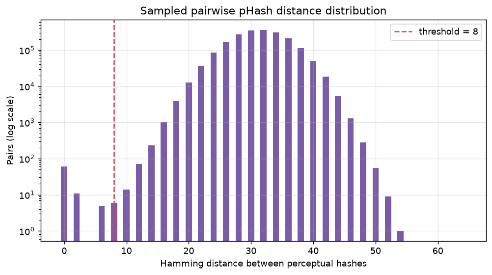
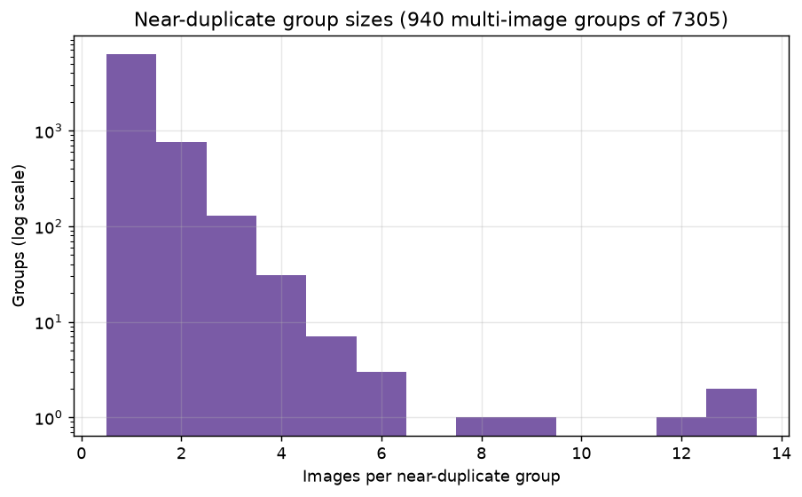
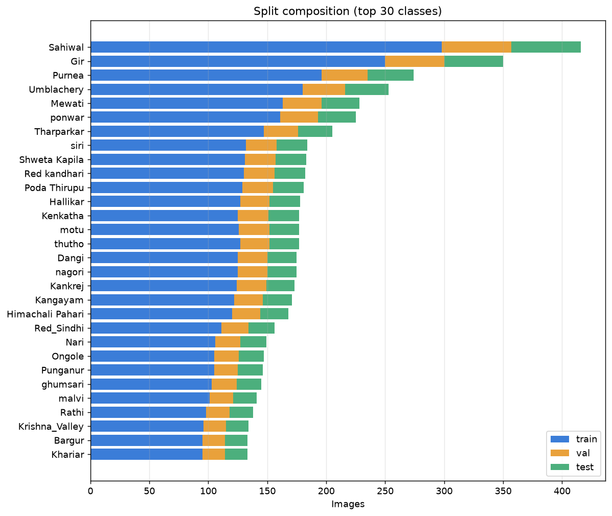

# BreedVision — Dataset Report (Phase 1)

**Generated:** 2026-08-19  
**Dataset version:** `v1`  
**Seed:** `42`  
**Source:** Kaggle `atharvadarpude/indian-cattle-image-dataset`  
**Raw root:** `C:\bv-data\raw`

Every figure in this report is generated by `ml/scripts/`. No value is hand-entered.

---

## 1. Totals

| Metric | Value |
|---|---|
| Files discovered | 8,539 |
| Valid images | 8,515 |
| Corrupt | 0 |
| Too small | 24 |
| Unreadable | 0 |
| Classes | 50 |
| Total size | 2.48 GB |

## 2. Class distribution

| Metric | Value |
|---|---|
| Classes | 50 |
| Smallest class | 83 (`Nimari`) |
| Median class size | 166 |
| Mean class size | 170.3 |
| Largest class | 421 (`Sahiwal`) |
| Imbalance ratio | 5.1x |





## 3. Image properties

| Percentile | Dimensions (W x H) | Megapixels |
|---|---|---|
| min | 100 x 83 | 0.01 |
| 25th pct | 240 x 194 | 0.05 |
| median | 275 x 225 | 0.05 |
| 75th pct | 564 x 424 | 0.25 |
| max | 6000 x 5713 | 24.06 |

**Formats:** `JPEG` (7,442), `PNG` (1,068), `GIF` (5)  
**Colour modes:** `RGB` (7,462), `RGBA` (1,024), `P` (25), `L` (4)



## 4. Duplicates and grouping

| Metric | Value |
|---|---|
| Exact-duplicate sets | 649 |
| Redundant files (exact) | 731 |
| Identical files under >1 class | 216 |
| pHash size / threshold | 8 bits² / 8 |
| Near-duplicate pairs | 1,682 |
| Groups after clustering | 7,305 |
| Multi-image groups | 940 |
| Images inside multi-image groups | 2,150 |
| Largest group | 13 |

The threshold was chosen from the sampled pairwise-distance distribution below: near-duplicates form a mode near zero, unrelated images a much broader mode. A threshold placed in the valley separates them.





## 5. Splits and leakage

Requested fractions: `{'train': 0.7, 'val': 0.15, 'test': 0.15}`  
Classes modelled: **49**  
Classes excluded by configuration:
- `Ayrshire` -- Not an Indian indigenous breed. Ayrshire is a Scottish dairy breed and falls outside the stated scope of Indian cattle identification.
Images dropped for contradictory labels (an identical file filed under more than one breed): **483**. See section 7.1.

| Split | Images | Fraction | Classes | Groups |
|---|---|---|---|---|
| train | 5,570 | 0.714 | 49 | 4,928 |
| val | 1,115 | 0.143 | 49 | 983 |
| test | 1,114 | 0.143 | 49 | 983 |

### Leakage measurement

This is the central result of Phase 1. Near-duplicate images straddling a split boundary inflate validation accuracy, because the model effectively sees validation images during training.

| Strategy | Cross-split near-duplicate pairs |
|---|---|
| Naive image-level split | **609** |
| Group-aware split (production) | **0** |

Groups spanning more than one split: **0** (must be 0)  
Acceptance: **PASS**



## 6. Representative images


## 7. Data quality concerns

These are measured properties of the dataset that constrain what can honestly be built on it. They are not reasons to abandon it, but they must shape Phase 2 and must not be omitted from any results claim.

### 7.1 Contradictory labels

**216 sets of byte-identical images appear under more than one breed label**, covering 483 files and touching 44 of 50 breeds.

The worst single case is one identical image filed under 4 different breeds: `Hariana`, `Ongole`, `Tharparkar`, `gaolao`. Those labels cannot all be correct.

Most affected breeds:

| Breed | Cross-class duplicate sets |
|---|---|
| `Ongole` | 43 |
| `gaolao` | 42 |
| `Shweta Kapila` | 40 |
| `malvi` | 38 |
| `gangatari` | 36 |
| `dagri` | 30 |

This is **demonstrated label noise, not an estimate**. It places a hard ceiling on achievable accuracy: no model can be right about an image whose ground truth contradicts itself. Grouping keeps these copies inside one split so they do not leak, but they still corrupt both the training signal and the evaluation.

### 7.2 Resolution is low for standard training sizes

Median short edge is **197 px**.

| Threshold | Images below | Share |
|---|---|---|
| short edge < 224 px | 5,106 | 60.0% |
| short edge < 300 px | 5,851 | 68.7% |
| short edge < 380 px | 6,267 | 73.6% |

Worst-affected classes (share below 224 px):

- `Krishna_Valley` -- 94.9%
- `Mewati` -- 94.8%
- `Purnea` -- 94.2%
- `siri` -- 94.0%
- `ponwar` -- 93.8%

With most of the dataset below 224 px, training at larger input sizes would mostly upscale rather than add detail. Phase 2 should test 224 px inputs first and treat larger-input variants as an experiment to justify, not a default.

### 7.3 Colour modes needing conversion

`RGBA` (1,024), `P` (25), `L` (4) -- all must be converted to RGB during preprocessing. RGBA in particular will otherwise be silently mishandled.

### 7.4 Coverage does not match the product scope

- The dataset is described as *Indian* breeds, but includes `Ayrshire` -- not an Indian indigenous breed.
- **No buffalo breeds are present.** All 50 classes are cattle. The product scope names cattle *and* buffaloes; on this dataset alone, buffalo identification cannot be built or claimed. A separate buffalo dataset would be required.

## 8. Reproduction

```bash
python ml/scripts/download_dataset.py
python ml/scripts/inspect_dataset.py
python ml/scripts/detect_duplicates.py
python ml/scripts/build_splits.py
python ml/scripts/make_report.py
```

All stochastic steps are seeded with `42` from `ml/config.yaml`. Re-running reproduces identical splits.

## 9. Limitations

- Near-duplicate grouping is a **proxy** for same-animal identity. The dataset carries no animal ID, so groups are inferred from perceptual similarity alone. Two photographs of the same animal from very different angles will not be grouped, so some same-animal leakage may remain. The measured cross-split count is therefore a lower bound.
- Breed labels are taken from directory names and have not been verified against an authority such as ICAR-NBAGR. Label noise is unmeasured.
- No bounding-box annotations are present, so Phase 6 cannot train a detector from this dataset (audit Risk R8).
- Class imbalance is carried into the splits by design; stratification preserves proportions rather than correcting them. Rebalancing is a Phase 2/4 modelling decision, not a dataset decision.
- Corrupt and undersized images are excluded from modelling but are retained in `inventory.parquet` for audit.