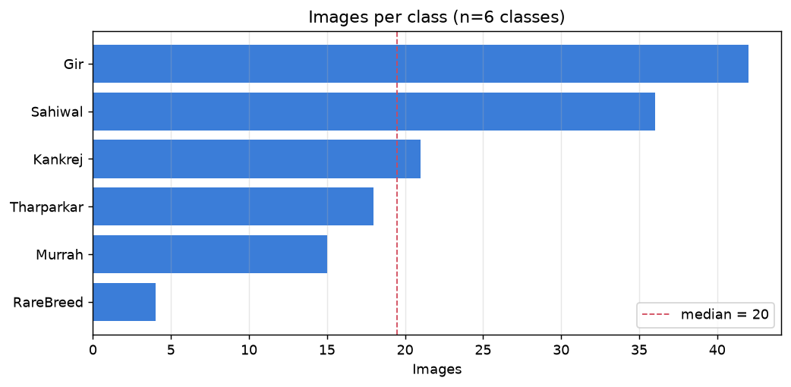
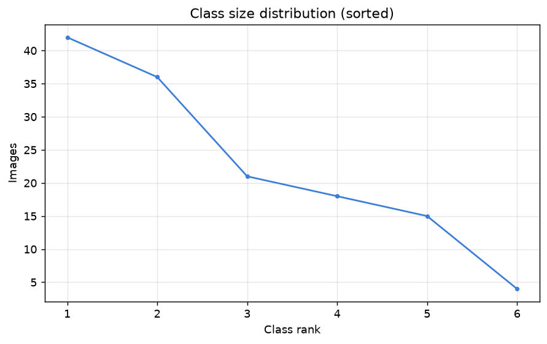
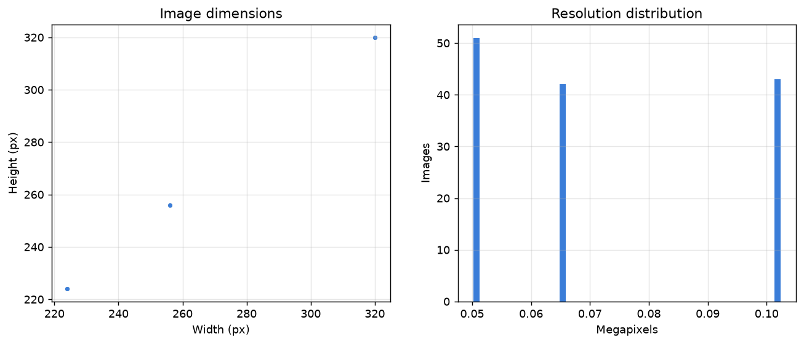
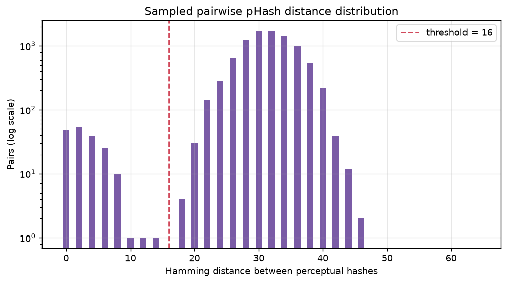
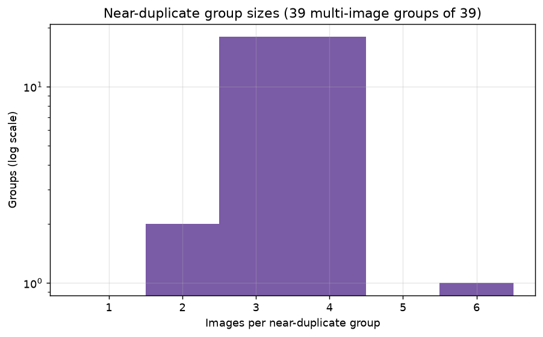
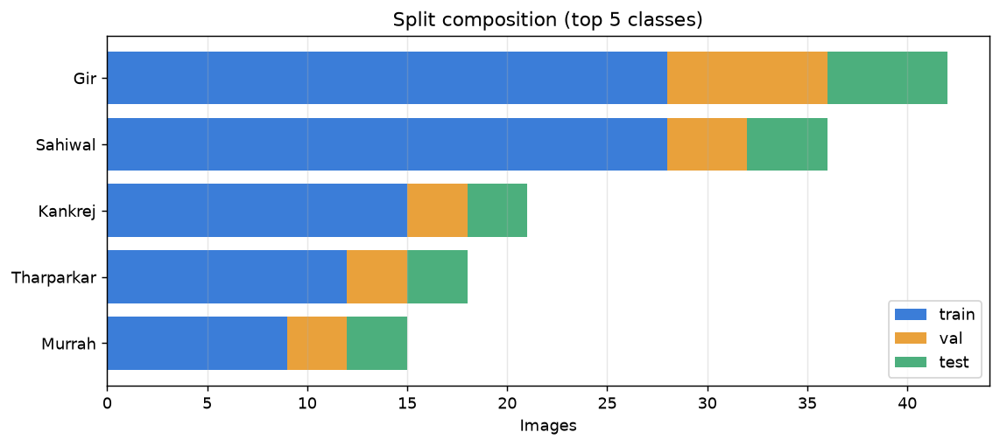
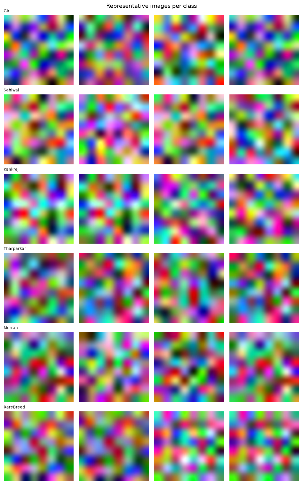

> ## ⚠️ THIS IS NOT THE REAL DATASET REPORT
>
> This file was generated from the **synthetic test fixture** in
> `ml/tests/make_fixture.py`, not from the Kaggle cattle dataset. It exists
> only to show what `ml/scripts/make_report.py` produces, and to prove the
> report generator works end to end.
>
> The real report will be written to `docs/dataset-report.md` once the dataset
> is downloaded. **Do not cite any number below as a property of the cattle
> dataset.**

# BreedVision — Dataset Report (Phase 1)

**Generated:** 2026-08-19  
**Dataset version:** `v1`  
**Seed:** `42`  
**Source:** Kaggle `atharvadarpude/indian-cattle-image-dataset`  
**Raw root:** `C:\bv-data\raw`

Every figure in this report is generated by `ml/scripts/`. No value is hand-entered.

---

## 1. Totals

| Metric | Value |
|---|---|
| Files discovered | 141 |
| Valid images | 136 |
| Corrupt | 3 |
| Too small | 2 |
| Unreadable | 0 |
| Classes | 6 |
| Total size | 0.00 GB |

## 2. Class distribution

| Metric | Value |
|---|---|
| Classes | 6 |
| Smallest class | 4 (`RareBreed`) |
| Median class size | 20 |
| Mean class size | 22.7 |
| Largest class | 42 (`Gir`) |
| Imbalance ratio | 10.5x |





## 3. Image properties

| Percentile | Dimensions (W x H) | Megapixels |
|---|---|---|
| min | 224 x 224 | 0.05 |
| 25th pct | 224 x 224 | 0.05 |
| median | 256 x 256 | 0.07 |
| 75th pct | 320 x 320 | 0.10 |
| max | 320 x 320 | 0.10 |

**Formats:** `JPEG` (136)  
**Colour modes:** `RGB` (136)



## 4. Duplicates and grouping

| Metric | Value |
|---|---|
| Exact-duplicate sets | 1 |
| Redundant files (exact) | 2 |
| Identical files under >1 class | 0 |
| pHash size / threshold | 8 bits² / 16 |
| Near-duplicate pairs | 179 |
| Groups after clustering | 39 |
| Multi-image groups | 39 |
| Images inside multi-image groups | 136 |
| Largest group | 6 |

The threshold was chosen from the sampled pairwise-distance distribution below: near-duplicates form a mode near zero, unrelated images a much broader mode. A threshold placed in the valley separates them.





## 5. Splits and leakage

Requested fractions: `{'train': 0.7, 'val': 0.15, 'test': 0.15}`  
Classes modelled: **5**  
Classes excluded (fewer than 10 images): **1** — `RareBreed`

| Split | Images | Fraction | Classes | Groups |
|---|---|---|---|---|
| train | 92 | 0.697 | 5 | 26 |
| val | 21 | 0.159 | 5 | 6 |
| test | 19 | 0.144 | 5 | 5 |

### Leakage measurement

This is the central result of Phase 1. Near-duplicate images straddling a split boundary inflate validation accuracy, because the model effectively sees validation images during training.

| Strategy | Cross-split near-duplicate pairs |
|---|---|
| Naive image-level split | **80** |
| Group-aware split (production) | **0** |

Groups spanning more than one split: **0** (must be 0)  
Acceptance: **PASS**



## 6. Representative images



## 7. Reproduction

```bash
python ml/scripts/download_dataset.py
python ml/scripts/inspect_dataset.py
python ml/scripts/detect_duplicates.py
python ml/scripts/build_splits.py
python ml/scripts/make_report.py
```

All stochastic steps are seeded with `42` from `ml/config.yaml`. Re-running reproduces identical splits.

## 8. Limitations

- Near-duplicate grouping is a **proxy** for same-animal identity. The dataset carries no animal ID, so groups are inferred from perceptual similarity alone. Two photographs of the same animal from very different angles will not be grouped, so some same-animal leakage may remain. The measured cross-split count is therefore a lower bound.
- Breed labels are taken from directory names and have not been verified against an authority such as ICAR-NBAGR. Label noise is unmeasured.
- No bounding-box annotations are present, so Phase 6 cannot train a detector from this dataset (audit Risk R8).
- Class imbalance is carried into the splits by design; stratification preserves proportions rather than correcting them. Rebalancing is a Phase 2/4 modelling decision, not a dataset decision.
- Corrupt and undersized images are excluded from modelling but are retained in `inventory.parquet` for audit.